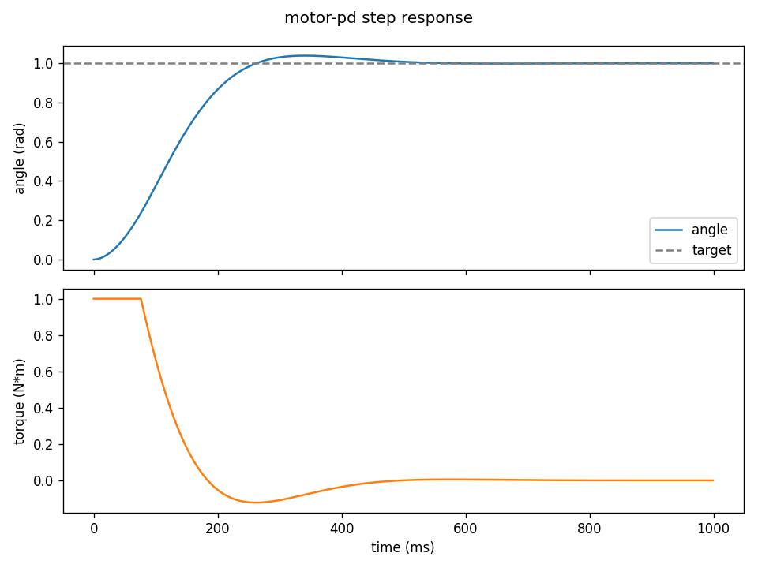

# motor-pd
A simple dc motor position controller in c: simulated motor, pd control with a torque limit, run at 1 khz with tests and a step-response plot.



## what it does

- The motor sim: a sim of a small dc motor: you give it torque, it gives back angle and speed, with friction slowing it down
- The PD controller: decides how much torque to apply each tick to get the motor to a target angle and stop there
- Tests: basic checks, it pushes toward the target, pushes back when it overshoots, never goes past the torque limit, and does nothing once it's parked 

## how to run

needs gcc and python with matplotlib.

```
gcc -Wall tests.c motor.c pd.c -o tests
./tests

gcc -Wall main.c motor.c pd.c -o sim
./sim > sim.csv
python plot.py
```


or just `./run.sh` in git bash / mac / linux.

## how it works

every 1 ms: check the motor, decide the torque, apply it. kp pushes harder the farther you are from the target, kd brakes harder the faster you're moving, so it slows down instead of overshooting. like parking a car.

## choices i made

- **1 khz loop:** a common motor control rate
- **torque clamp (±1):** stands in for real motor limits; you can see it kick in at the start of the plot
- **J = 0.01, b = 0.1:** a small, quick motor (top speed 10 rad/s)
- **kp = 2, kd = 0.1:** tuned by watching the step response

## next steps

if I were to keep going I would add:

1. a simulated encoder so the controller reads counts instead of perfect angle
2. add a timeout so the motor goes to zero torque if it stops getting targets
3. run the loop on an esp32 timer interrupt instead of a simulated loop

## notes

I wrote the motor model, the controller, the tests, and the run.sh. the plot scripts were written with the help of ai.